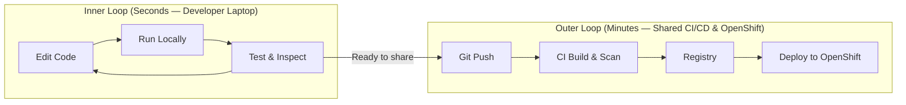

# Inner-Loop Development with Podman, Podman Compose & Red Hat UBI 9

Welcome! This repository is a hands-on, step-by-step walkthrough showing how teams can build, run, and test containerized applications comfortably on their own laptops — while staying aligned with **Red Hat Enterprise Linux (RHEL)** and **Red Hat OpenShift Container Platform (OCP)** from day one.

Whether you are new to containers or modernizing an existing delivery workflow, this guide walks through **what inner-loop development is**, **why it matters**, and **how to progress smoothly** from a single container to a multi-service, OpenShift-ready stack.

---

## What Is Inner-Loop Development?

Modern software delivery happens in **two loops**:



- **The Inner Loop** is the rapid, everyday cycle a developer repeats dozens of times a day: *edit code → run it → see the result → refine*. Everything stays local, fast, and easy to experiment with.
- **The Outer Loop** begins when you commit and push changes: automated pipelines build official images, run security scans, push to a registry, and roll the application out to shared environments like **OpenShift**.

---

## Why Does a Good Inner Loop Matter?

When local development is slow or looks nothing like production, teams pay for it every single day. Investing in a clean, container-based inner loop solves four common problems:

1. **Instant feedback keeps developers in flow.** Waiting 5–15 minutes for a remote pipeline just to verify a small code change breaks focus. A strong inner loop brings that feedback down to seconds.
2. **Goodbye, "it works on my machine."** Running locally inside the same Red Hat enterprise base images you deploy in production catches environment, port, and networking differences early — before code ever reaches CI.
3. **Smooth path to OpenShift security.** OpenShift enforces strict security defaults (such as running containers without root privileges and assigning random user IDs). Building with rootless **Podman** and **Red Hat UBI 9** locally means your app is already compatible when it reaches the cluster.
4. **Clean, repeatable onboarding.** Instead of a 20-step local setup guide, a new teammate can clone the repo, run one command, and have a working multi-service environment in moments — then remove it cleanly when finished.

---

## Why This Stack?

Every example in this repository intentionally uses a simple, consistent **Red Hat-aligned stack**:

- **Podman** — Runs containers securely without a privileged background daemon and without requiring root access.
- **Podman Compose** — Lets you describe multi-container setups, shared folders, private networks, and health checks in a single readable `compose.yml` file.
- **Red Hat Universal Base Images (UBI 9)** — Enterprise-grade, freely redistributable base images (`httpd-24`, `nginx-124`, `nodejs-20`) built on RHEL foundations and designed for OpenShift out of the box.

---

## What's Inside This Repository

This repository is organized as a **6-stage learning journey**. Each folder builds naturally on the previous one and includes its own short walkthrough so you can explore at your own pace or present it live step by step.

### Stage 0 — Packaging Apps for OpenShift ([`00-containerfiles/`](./00-containerfiles/README.md))
*How do we package an app so it runs safely on both a laptop and OpenShift?*  
Introduces two well-commented container recipes: a straightforward single-stage build and a lean **multi-stage build** that leaves build tools behind so production images stay small and secure. Also shows how to simulate OpenShift's strict non-root security model right on your laptop.

### Stage 1 — Running Your First Container ([`01-simple-http/`](./01-simple-http/README.md))
*What are the everyday basics of running a container?*  
Starts with a single Red Hat Apache web server. Walks through starting, checking, stopping, and removing a container by hand, then shows how describing that same setup in a `compose.yml` file makes it repeatable.

### Stage 2 — Instant Feedback with Live Reload ([`02-volumes-live-reload/`](./02-volumes-live-reload/README.md))
*How do developers edit code without rebuilding a container every time?*  
The core of inner-loop productivity. Connects your local source code directly into a running container so saving a file immediately updates the live application in under a second — no rebuild, no manual restart.

### Stage 3 — Multiple Services & Private Networks ([`03-multi-container-networks/`](./03-multi-container-networks/README.md))
*How do real apps with multiple pieces talk to each other safely?*  
Runs a small three-part application (**Web → API → Datastore**) across separate frontend and backend networks. Demonstrates how containers find each other automatically by name while keeping internal services unreachable from the outside.

### Stage 4 — Knowing When to Rebuild ([`04-rebuild-workflow/`](./04-rebuild-workflow/README.md))
*When do live edits stop being enough?*  
Shows how to rebuild immutable container images cleanly whenever dependencies, versions, or packaging instructions change — including automated rebuild-on-change workflows for the inner loop.

### Stage 5 — Local Integration Testing ([`05-integration-healthchecks/`](./05-integration-healthchecks/README.md))
*How do we make sure the entire application starts and works together reliably?*  
Combines everything into a full integration setup: building each service from its own directory, adding health checks so each component reports when it is truly ready, and starting dependent services in the right order.

---

## Overview at a Glance

| Stage | Focus | What You'll Learn |
| :--- | :--- | :--- |
| **[00-containerfiles](./00-containerfiles/README.md)** | OpenShift-Ready Packaging | Single-stage vs. multi-stage builds and non-root security practices |
| **[01-simple-http](./01-simple-http/README.md)** | Container Basics | Everyday container lifecycle and your first `compose.yml` |
| **[02-volumes-live-reload](./02-volumes-live-reload/README.md)** | Fast Inner Loop | Sharing local code into a container for instant live reload |
| **[03-multi-container-networks](./03-multi-container-networks/README.md)** | Multi-Service Apps | Service-to-service communication and network isolation |
| **[04-rebuild-workflow](./04-rebuild-workflow/README.md)** | Image Rebuilds | Clean image rebuilds when packaging or dependencies change |
| **[05-integration-healthchecks](./05-integration-healthchecks/README.md)** | Integration Readiness | Coordinated startup, health checks, and end-to-end local testing |

---

## Getting Started

1. **Install prerequisites:** Have [Podman](https://podman.io/) and `podman compose` available on your machine.
2. **Clone this repository:**
   ```bash
   git clone https://github.com/varkrish/inner-loop-containers.git
   cd inner-loop-containers
   ```
3. **Follow any stage:** Open a stage folder (starting with [`00-containerfiles/`](./00-containerfiles/README.md) or [`01-simple-http/`](./01-simple-http/README.md)) and follow its short walkthrough.

Want to check that everything works on your machine before presenting or experimenting? Run the included end-to-end check:

```bash
./verify-demo.sh
```
